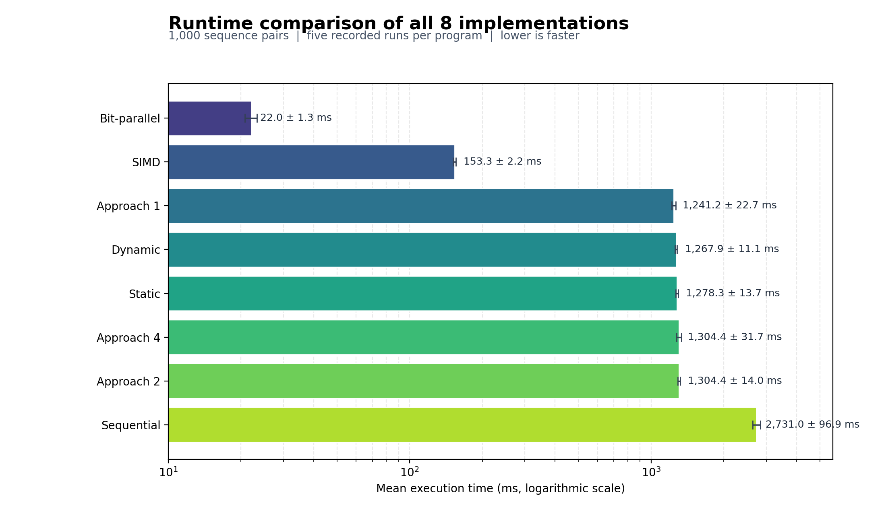

# DNA Comparison Load Balancing Using OpenMP

This repository contains eight C++ sequence-alignment implementations, their
input datasets and recorded results, and a plot comparing the implementations'
runtime.

## Runtime comparison

The chart below summarizes the five runs recorded for each implementation.

The interactive project page is published with GitHub Pages.

## Project contents

- C++ implementations and the shared Needleman-Wunsch header
- Input datasets in `data/`
- Recorded benchmark results in `results/`
- Chart, source data, and plotting script in `plot/`

The benchmark dataset `data/chromosome21.fasta` identifies itself as the
GRCh38.p14 chromosome 21 reference assembly.
